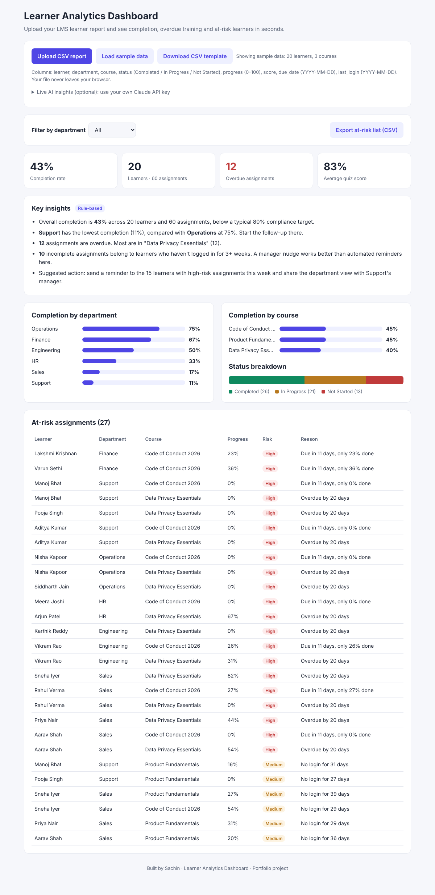

# Learner Analytics Dashboard

Upload a learner report from any LMS and instantly see completion rates, overdue training, at-risk learners and AI-written insights.

**Live demo:** https://sachin-0915.github.io/lms-learner-analytics/

## The problem
L&D managers spend hours every month exporting LMS reports into Excel to answer simple questions: *Who hasn't finished compliance training? Which team is behind? Who should I chase this week?* Most LMS platforms show raw data but don't tell managers **what to do next**, so overdue training is often found only at audit time.

## Who it's for
- **L&D / training managers** who track mandatory and compliance training
- **HR business partners and department heads** who follow up with their teams
- **LMS product teams** designing manager-facing reporting

## What it does
| Feature | Why it matters |
|---|---|
| CSV upload (works with exports from any LMS) | No integration needed, so it's usable on day one |
| KPI cards: completion %, learners, overdue, average score | A health check in 5 seconds |
| Completion by department and by course | Shows where to focus |
| **At-risk detection** with a plain-language reason | Turns data into a follow-up list |
| Department filter | Each manager sees their own team |
| Export at-risk list as CSV | Ready to send for reminder emails |
| Insights: rule-based, or AI-generated with the Claude API | Explains the "so what" for non-analysts |
| Data stays in the browser | Safe for learner personal data |

### At-risk rules (product logic)
| Risk | Rule |
|---|---|
| High | Assignment is past its due date and not completed |
| High | Due within 14 days and less than 50% progress |
| Medium | No login for 21+ days |
| Medium | Not started and due within 30 days |

## Success metrics (for a real product)
- **Overdue assignments reduced** month over month (target: −30% in one quarter)
- **Time to produce the monthly training report:** from hours to under 5 minutes
- **Manager adoption:** % of managers opening the dashboard weekly
- **Compliance completion rate** before the audit deadline (target: 95%+)

## How it works
- Single-page web app (HTML, CSS, JavaScript) with no server, hosted free on GitHub Pages
- The CSV is parsed and analysed entirely in the browser
- In AI mode, only an **aggregated summary** (not the full file) is sent to the Claude API to generate manager-ready insights

## Try it
Open the live demo. Sample data loads automatically. Click **Download CSV template** to see the file format, then upload your own file.

## Roadmap
- Automated reminder emails to at-risk learners and their managers
- Trends over time (compare monthly uploads)
- Direct LMS integration through an API
- Prediction of drop-off risk based on engagement patterns

---
Built by **Sachin**, a product specialist with 6 years in the LMS domain, using AI-assisted development (Claude Code).
